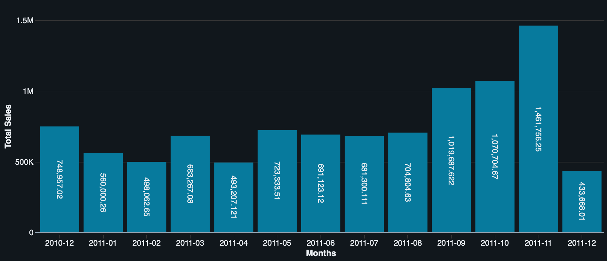
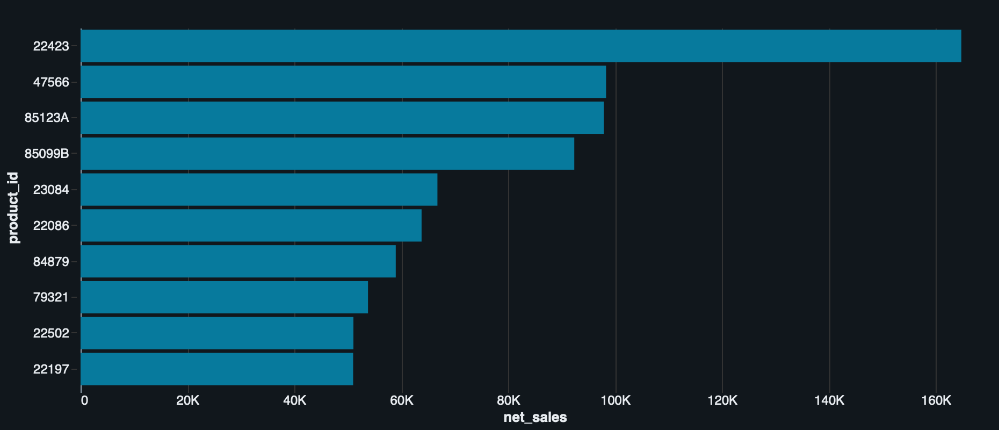

# Retail Sales Analytics Lakehouse

A retail data pipeline and sales analysis built with **Databricks Free Edition, PySpark, Delta Lake, and SQL**.

I built this project to work through both sides of an analytics problem: preparing reliable tables and explaining what the numbers actually mean. It uses the UCI Online Retail dataset, with 541,909 transaction lines from a UK retailer, to examine sales, product performance, and repeat purchasing.

[Read the analysis](reports/findings.md) · [Explore the pipeline](notebooks/01_pipeline.py) · [Run the project](docs/setup.md)

## Results at a glance

| Measure | Full dataset |
| --- | ---: |
| Lines included in sales analysis | 539,392 |
| Lines excluded for zero or negative prices | 2,517 |
| Net recorded sales | £9,769,872.054 |
| Distinct sale orders | 19,960 |
| Identified purchasing customers | 4,338 |
| Identified customers with two or more sale orders | 65.58% |

These results come from the completed Databricks run. A second run returned the same row counts and net-sales total, and SQL checks matched the pipeline totals. The updated Python notebook also passed full-data row accounting and daily/product reconciliation on Python 3.12.3 and Spark 4.2.0, matching the earlier totals. See the [run record](reports/runtime-validation.md) and [validation](docs/validation.md).

## What the analysis showed

- **November 2011 had the highest net sales**, at £1,461,756.25. December 2011 ends on the ninth, so comparing its total with a full month would be misleading.
- **Postage appeared among the top sales codes.** I checked the descriptions and separated `DOT` and `POST` from the merchandise ranking. REGENCY CAKESTAND 3 TIER was the leading merchandise code at £164,762.19.
- **Customer coverage matters.** Of the eligible lines, 24.58% had no customer ID. They contribute to sales totals but cannot be used to measure repeat purchasing.

### Monthly net sales



Values are net sales in GBP, despite the exported chart's “Total Sales” axis label. December 2011 covers December 1–9 only.

### Top merchandise codes



The ranking excludes `DOT` and `POST`. Product codes are used because descriptions sometimes vary within a code. All ten displayed codes were checked against their source descriptions.

## How it works

```text
UCI workbook → CSV → Bronze Delta → Silver Delta → Gold Delta → SQL analysis
                                         └────→ Rejected rows
```

Bronze keeps the input rows and ingestion metadata. Silver adds typed fields and quality flags. Gold provides daily, product, and customer summaries. Rows with missing customer IDs remain eligible for sales; zero and negative prices are kept for review but excluded from the monetary metrics.

I retained duplicate-looking lines because invoice and product codes do not establish a unique transaction-line key. Monetary calculations use decimals. Negative quantities are treated as recorded adjustments, not confirmed cash refunds. Costs are absent, so this project does not calculate profit.

## Run it

1. Convert the workbook with [scripts/prepare_data.py](scripts/prepare_data.py).
2. Upload the CSV to a Unity Catalog volume.
3. Import the shared functions, smoke checks, and one pipeline format into the same Databricks folder.
4. Run the smoke checks, configure the pipeline, then enable the full refresh and run it.

The [setup guide](docs/setup.md) covers the commands, paths, and table names. Each refresh replaces six project tables, one at a time; use a dedicated schema and rerun the whole notebook after an interruption.

## Repository guide

| Folder | Contents |
| --- | --- |
| [notebooks](notebooks/) | PySpark pipeline, shared transformations, and smoke checks |
| [sql](sql/) | Sales and customer analysis |
| [reports](reports/) | Findings, charts, and execution records |
| [docs](docs/) | Setup, architecture, data rules, and validation |
| [tests](tests/) | Workbook conversion and notebook preflight tests |
| [scripts](scripts/) | Workbook-to-CSV conversion |

## Dataset

Chen, D. (2015). [Online Retail](https://doi.org/10.24432/C5BW33). UCI Machine Learning Repository. [Source page](https://archive.ics.uci.edu/dataset/352/online+retail) · [CC BY 4.0](https://creativecommons.org/licenses/by/4.0/).

The observation period is December 1, 2010–December 9, 2011, with prices in sterling. Raw files and customer-level outputs stay outside Git. The code license has not been selected; the dataset retains its own license and attribution.

