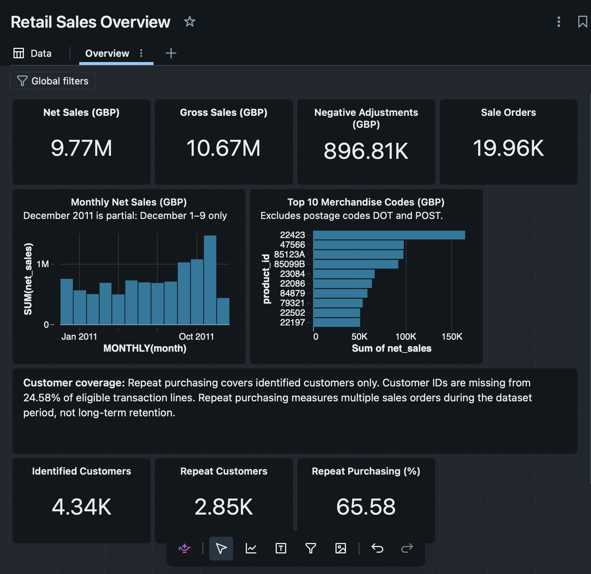

# Retail Sales Overview

[Dashboard definition](retail_sales_overview.lvdash.json) · [Screenshot](../reports/figures/retail_sales_overview.png)

This Databricks dashboard brings the validated sales, merchandise, and customer metrics onto one Overview page. The definition is the original export from October 31, 2026, with its queries, layout, and formatting unchanged.

## Contents

- Four sales cards: net sales, gross sales, negative adjustments, and distinct sale orders.
- Monthly net-sales chart, with December 2011 labeled as a partial month.
- Top ten merchandise codes, ordered by net sales and excluding postage codes DOT and POST.
- Three customer cards: identified customers, repeat customers, and repeat-purchasing percentage.
- Customer-coverage note explaining missing IDs and the observation-window limit.

## Use in Databricks

Run the [pipeline](../notebooks/01_pipeline.py) first, then import the `.lvdash.json` definition using Databricks' dashboard import option and select an available SQL warehouse. If your catalog or schema differs, edit each dataset's table references before running it.

The queries currently read:

- `workspace.retail_learning.retail_silver`
- `workspace.retail_learning.retail_gold_daily`
- `workspace.retail_learning.retail_gold_product`
- `workspace.retail_learning.retail_gold_customer`

Refresh and compare the results with the [findings](../reports/findings.md): GBP 9,769,872.054 net sales, 19,960 sale orders, 4,338 identified purchasing customers, and 65.58% repeat purchasing. Counter formatting abbreviates large values; it does not change the underlying totals. The percentage is already multiplied by 100 in SQL and uses ordinary number formatting.

## Scope and checks

The export has four datasets, seven counters, two bar charts, and one text widget. Dataset references, encoded field names, layout dimensions, and the merchandise sort were checked. The dataset results were matched to the validated outputs during dashboard construction. A fresh copy imported from this file was visually checked on November 3, 2026. The expected KPI values, both charts, merchandise ranking order, and explanatory notes appeared correctly. See [the import record](../reports/dashboard-import-check.md).

These are full-period summaries. No date or country filter is configured; adding a filter would require checking that it applies consistently to all four datasets. Customer figures cover identified purchasing customers only; 24.58% of eligible lines lack an ID. December 2011 ends on the ninth, and negative adjustments do not establish paid refunds.

The screenshot shows the editable dashboard, including its toolbar. This repository contains the definition and preview, not a public live dashboard. Publication and sharing settings are managed separately in Databricks. No warehouse ID, account URL, credentials, or customer-level records are included in the export.
