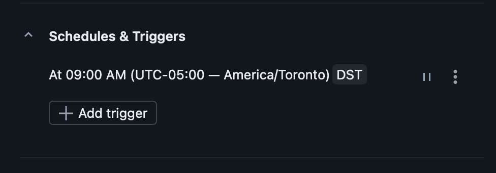

# Daily pipeline job

## Configuration

| Setting | Value |
| --- | --- |
| Job | Retail Sales Pipeline |
| Task | refresh_retail_tables |
| Type | Workspace notebook |
| Notebook | 01_pipeline |
| Compute | Serverless |
| Trigger | Daily at 09:00, America/Toronto |
| Saved status | Active |
| Loading method | Full refresh of six project tables |

The job's manual test run succeeded on November 3, 2026 in approximately 1 minute 15 seconds, as shown in the run-history screenshot reviewed during setup. Its exact job-run reconciliation output was not separately captured. The notebook's earlier interactive full-data reconciliation and repeat runs are recorded in [runtime validation](../reports/runtime-validation.md).

The daily schedule was saved after 09:00 on November 3. The first expected scheduled run is November 4 at 09:00 Toronto time. This is a configured schedule; no automatically triggered run has yet been verified.

## Before the next run

The workspace notebook must retain the full CSV path and `ALLOW_FULL_REFRESH = True`. The GitHub source defaults to the sample and disables writes, so replacing the workspace notebook from GitHub requires reviewing its configuration again. Keep `00_transformations` beside the pipeline for relative `%run` to resolve.

The task runs the workspace copy, not a pinned Git revision. Scheduling a full refresh does not make ingestion incremental. Dashboard refresh is separate. The static source will produce the same business totals unless its contents change; Free Edition quotas can affect run availability.

## Verify automatic execution

After the scheduled time, check run history for a schedule-triggered run, its final status, and reconciliation output. Capture the input count and net-sales total and record any quota or execution failure. Pause the trigger when the demonstration is no longer needed.

No account email, workspace URL, or job identifier is published in this record.
