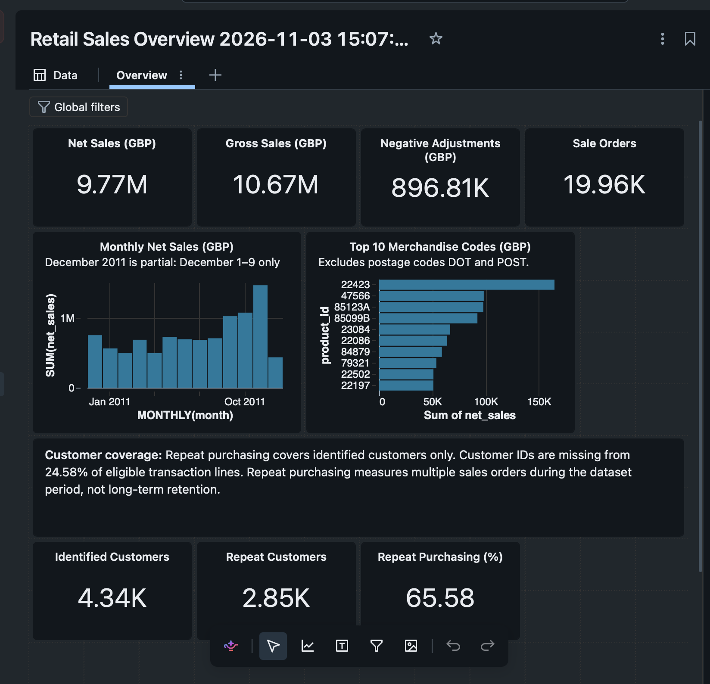

# Dashboard import check

**Date:** November 3, 2026

The saved `Retail Sales Overview.lvdash.json` was imported as a new dashboard copy. The screenshot below shows the date-suffixed copy with the Overview page and its populated widgets.

| Item checked | Display |
| --- | --- |
| Net sales (GBP) | 9.77M |
| Gross sales (GBP) | 10.67M |
| Negative adjustments (GBP) | 896.81K |
| Sale orders | 19.96K |
| Identified customers | 4.34K |
| Repeat customers | 2.85K |
| Repeat purchasing (%) | 65.58 |
| Monthly net-sales chart | Present, with December 2011 partial-month note |
| Merchandise chart | Present; 22423, 47566, 85123A lead the descending ranking |
| Coverage text | Present; 24.58% missing customer-ID line coverage and retention limitation |

The abbreviated figures agree with the exact [analysis results](findings.md). The imported layout preserved the charts, notes, and ranking order.

This check used the existing project tables in the same Databricks workspace. It confirms that the saved definition can be imported and rendered with the expected visible content. It does not establish a clean-workspace table rebuild, public publication, or a separately audited refresh event.

The manual batch pipeline, SQL analysis, and dashboard deliverable is complete. Scheduling, incremental ingestion, and production deployment remain outside this scope.
